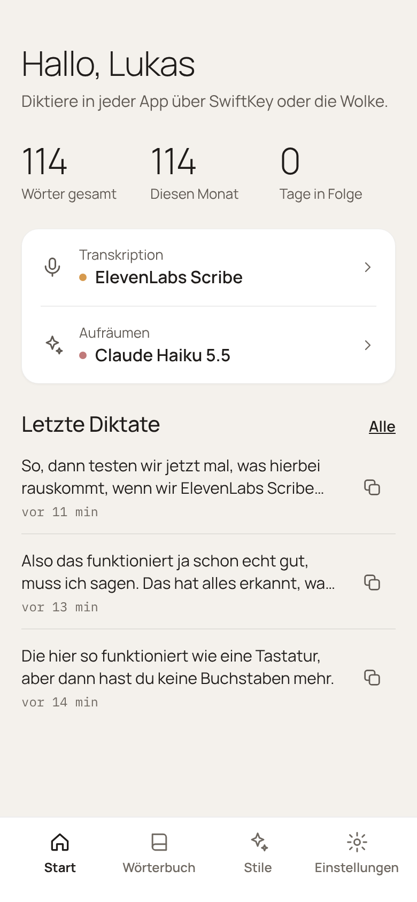
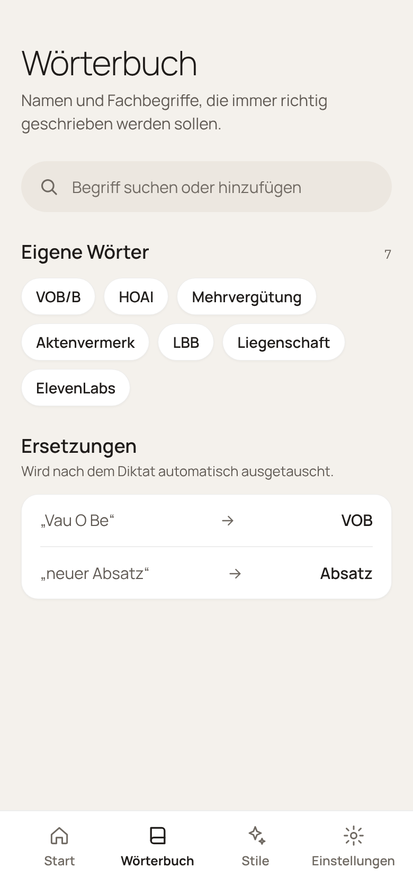
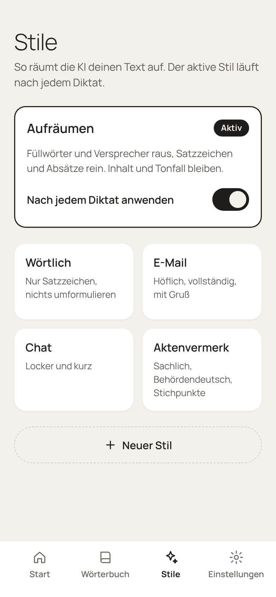
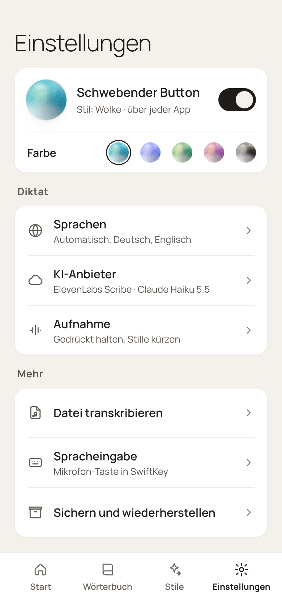
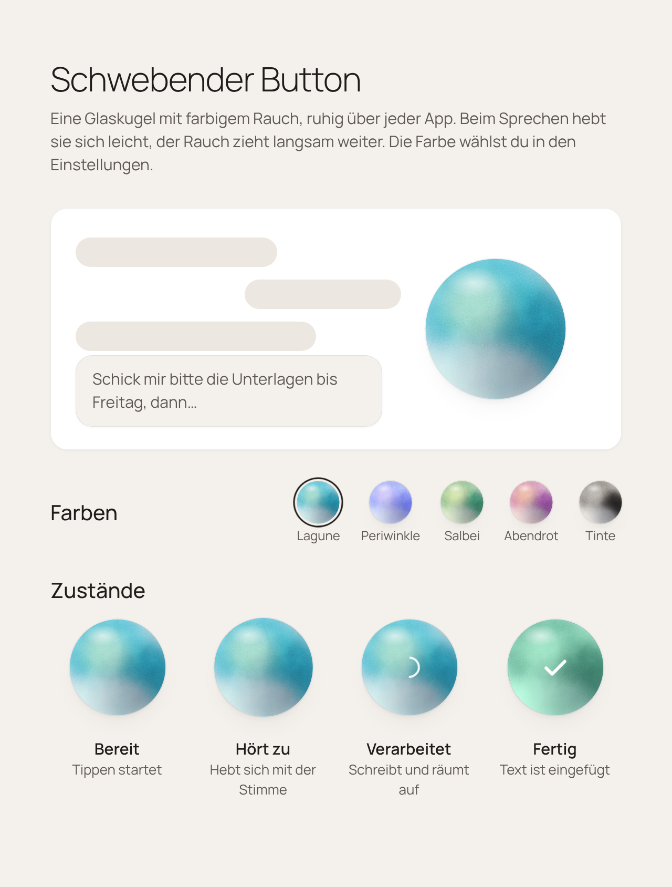

<p align="center">
  <picture>
    <source media="(prefers-color-scheme: dark)" srcset="docs/design/icon/export/svg/diktat-icon-white.svg">
    
  </picture>
</p>

<h1 align="center">diktat</h1>

<p align="center">
  Diktieren in jeder Android-App: sprechen, die KI räumt den Text auf, er steht im Feld.<br>
  Mit eigenen API-Keys, ohne Konto, ohne Server dazwischen, ohne Telemetrie.
</p>

---

## Was diktat kann

- **Schwebender Button „Wolke“** über jeder App, neben der Tastatur deiner Wahl (z. B. SwiftKey). Antippen zum
  Starten und Stoppen oder gedrückt halten zum Aufnehmen, wählbar unter Einstellungen › Aufnahme.
- **Langdiktat**: Lange Diktate werden schon während des Sprechens in Abschnitten transkribiert, geschnitten an
  Sprechpausen. Am Ende ist der Text fast sofort da.
- **Spracheingabe für andere Tastaturen**: SwiftKeys Mikrofon-Taste und Apps, die Androids Spracherkennung nutzen,
  diktieren über diktat.
- **Stile**: Wie die KI aufräumt. Mitgeliefert sind Aufräumen, Wörtlich, E-Mail, Chat und Aktenvermerk. Eigene Stile
  lassen sich im Tab „Stile“ anlegen, bearbeiten und löschen. Der aktive Stil läuft nach jedem Diktat.
- **Wörterbuch**: Eigene Wörter (Namen, Fachbegriffe), die das Sprachmodell richtig schreiben soll, und Ersetzungen,
  die nach dem Diktat automatisch getauscht werden.
- **Datei transkribieren**: Audio- und Videodateien teilen oder mit diktat öffnen.
- **Verlauf und Statistik**: Letzte Diktate zum Kopieren, Wörter gesamt, diesen Monat, Tage in Folge.
- **Offline-Erkennung** auf dem Gerät, ganz ohne Netz und Anbieter.
- **Sichern und Wiederherstellen** aller Einstellungen, auf Wunsch mit API-Keys.
- **Einfügen, das nicht verloren geht**: Nimmt eine App den Text nicht an, liegt er in der Zwischenablage und
  wird beim nächsten Tippen ins Feld oder auf die Wolke eingefügt.

### Anbieter

Transkription und Aufräumen sind getrennt wählbar, jeweils mit eigenem Schlüssel:

OpenAI · ElevenLabs Scribe · Anthropic (Claude) · Groq · Google Gemini · Mistral · Deepgram · AssemblyAI · Soniox ·
Azure Speech · OpenRouter · DeepInfra · Together AI · xAI (Grok) · DeepSeek · SiliconFlow · Scaleway · OVHcloud ·
Ollama · eigener OpenAI-kompatibler Server · On-device (offline)

## Oberfläche

Warmer, ruhiger Look („Entwurf 3“): Papier und Tinte, Manrope und IBM Plex Mono, vier Tabs, hell und dunkel. Die
Bilder sind die Design-Referenzen aus [`docs/design/entwurf-3/`](docs/design/entwurf-3/), nach denen die App gebaut ist.

<p align="center">
  
  
  
  
</p>

Die **Wolke** ist eine Glaskugel mit farbigem Rauch, die sich beim Sprechen leicht hebt. Es gibt fünf Paletten:
Lagune, Periwinkle, Salbei, Abendrot und Tinte.

<p align="center">
  
</p>

## Einrichten

1. APK installieren (siehe [Bauen](#bauen)) und öffnen.
2. Anbieter wählen und API-Key eintragen, z. B. ElevenLabs für die Transkription und Anthropic für das Aufräumen.
   Oder ein Offline-Modell laden.
3. **Wolke**: Unter Einstellungen › Schwebender Button einschalten und in Android die Bedienungshilfe „diktat
   Floating-Button“ erlauben. Die Wolke erscheint, sobald ein Textfeld aktiv ist.
4. **Optional, Mikrofon-Taste in SwiftKey**: Unter Einstellungen › Spracheingabe diktat als Eingabemethode
   einschalten. Deine Tastatur bleibt, wie sie ist.

## Bauen

```bash
./gradlew :app:assembleDebug
```

Die APK liegt unter `app/build/outputs/apk/debug/`. Debug-Builds haben das Paket `net.devemperor.dictate.debug` und
sind mit einem Debug-Schlüssel signiert.

## Datenschutz

diktat betreibt keinen Server. Aufnahmen gehen direkt vom Gerät zum Anbieter, den du eingetragen hast, oder bleiben
bei Offline-Erkennung auf dem Gerät. Keys, Stile, Verlauf und Einstellungen liegen nur auf dem Gerät. Einzelheiten
in der [Datenschutzerklärung](PRIVACY_POLICY.md).

## Dokumentation

- [`docs/FUNKTIONEN.md`](docs/FUNKTIONEN.md): Was die App können soll und heute kann
- [`docs/design/diktat-design.md`](docs/design/diktat-design.md): Design-Entscheidungen (Oberfläche, Wolke, Icon)
- [`CLAUDE.md`](CLAUDE.md): Arbeitsstand und nächste Aufgaben

## Herkunft und Lizenz

diktat ist ein Fork von [Dictate Keyboard](https://github.com/DevEmperor/DictateKeyboard) von DevEmperor, das
seinerseits auf [FlorisBoard](https://github.com/florisboard/florisboard) von Patrick Goldinger und Mitwirkenden
aufbaut. Aus Dictate Keyboard stammen die Diktier-Logik, die Anbieter und der schwebende Button. Neu in diktat sind
die Oberfläche, die Wolke, das Icon und die Stile. Die Tastatur und ihr Zubehör sind entfernt.

Lizenz: [Apache 2.0](LICENSE), siehe auch [NOTICE](NOTICE). Lizenzen der verwendeten Bibliotheken und Modelle stehen
in der App unter Über.
